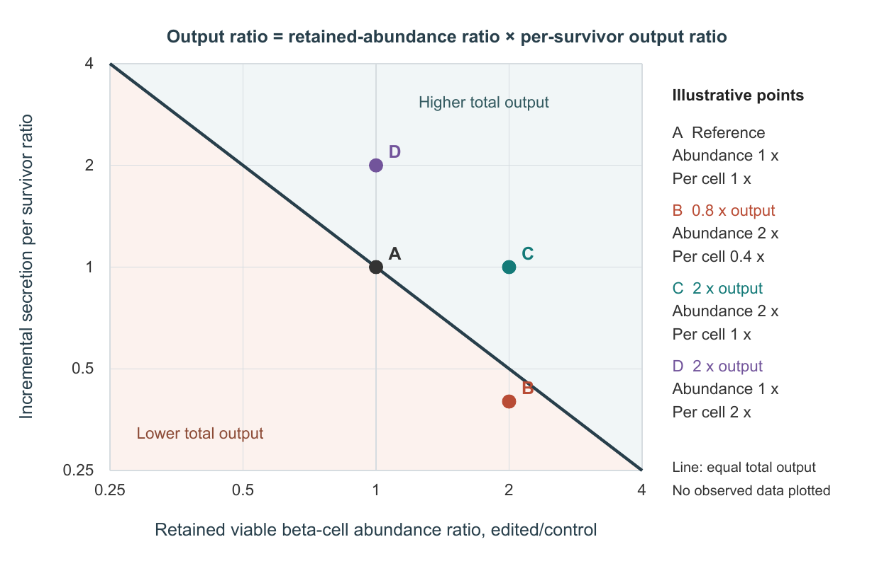

<div align="center">

# Andrew3

### Immune protection with useful beta-cell function

Screen reanalysis · Evidence assessment · Experimental framework

[**Foundation paper**](manuscript/paper.pdf) · [**Perspective**](functional_protection/paper.pdf) · [**Reproduce**](#reproduce-the-work) · [**Evidence**](#explore-the-evidence)

[](requirements-lock.txt)
[](evidence/release_validation.json)
[](functional_protection/validation.json)

</div>

## The question

> Can edited human beta cells resist immune injury while supplying useful, glucose-responsive insulin output in the same preparation over time?

Andrew3 connects a screen reanalysis with an evidence-informed framework for testing functional protection. It distinguishes **relative benefit over an injured control**, **adequate regulated output**, and **reliable performance within preparations over time**.

## Read the papers

| | Foundation reanalysis | Functional-protection Perspective |
| :--- | :--- | :--- |
| **Focus** | Do nominated candidates rank unusually highly in a second screen, and what evidence links protection with secretion? | How should experiments establish useful output under immune pressure, and which additional claims do the measurements support? |
| **Contribution** | Screen reanalysis and a bounded, candidate-specific evidence assessment | Endpoint definitions, hypothetical examples and a proposed experimental framework requiring calibration |
| **Read** | [PDF](manuscript/paper.pdf) · [Word](manuscript/paper.docx) · [Result report](REPORT.md) | [PDF](functional_protection/paper.pdf) · [Word](functional_protection/paper.docx) · [Source ledger](functional_protection/source_ledger.json) |
| **Reconstruct** | [Provider downloads](docs/provider_reconstruction.md) and the root analysis pipeline | [Independent instructions](functional_protection/README.txt) and [Supplement S1](functional_protection/supplement_S1.json) |

## What the work shows

**The nominated set does not show positive rank enrichment.** Six scored human counterparts of eleven mouse autoimmune-screen discoveries yield **theta = 0.421** and **one-sided p = 0.744**. This is a gene-label competitive rank comparison, not a biological efficacy estimate or proof that each edit is ineffective.

**Protection and secretion need linked evidence.** The foundation assessment located adequate candidate-specific post-immune basal/stimulated secretion comparisons for **0/6 eligible candidates** and **0/11 original discoveries**. These are evidence-coverage counts, not biological failure rates. RNLS has favorable short-term human culture survival observations alongside adverse graft findings; baseline function and 72-hour survival do not establish durable functional protection.

**Useful output is the central product-level question.** The Perspective separates regulated output from increased cell retention and preserved function per survivor. Its calculations are hypothetical, and its proposed acceptance criteria require calibration. It reports no new biological experiment.

### Why survival alone is not enough



*Illustrative calculations from the Perspective; no observed data are plotted. Each point is relative to its matched challenged control. More retained cells can coexist with less glucose-induced output, while improved secretion can increase output without greater retention. The [paper](functional_protection/paper.pdf) explains the comparisons and their limits.*

## Reproduce the work

Run the commands below from the repository root in a Python 3.12 environment. The two pipelines are independent.

### 1. Foundation reanalysis

```bash
python -m pip install -r requirements-lock.txt
python src/fetch_public_inputs.py
python reproduce.py
```

The downloader obtains **nine provider objects for ten required input paths** and verifies their original SHA-256 hashes. Reconstruction then runs offline: all analysis stages, evidence-table generation, figures and the test suite. It uses the repository's frozen literature curation; it does not repeat historical searches or independently re-extract article evidence.

[Provider download guide and manual fallback](docs/provider_reconstruction.md) · [Portable validation rules](docs/portable_validation.md)

### 2. Functional-protection Perspective

```bash
python -m pip install -r functional_protection/requirements.txt
python functional_protection/reproduce.py
```

This runs **eight analytical checks**, regenerates the hypothetical examples and figure, and builds the Word manuscript. Poppler's `pdftoppm` must be on PATH. Foundation downloads are not required for this pipeline.

[Perspective reproduction guide](functional_protection/README.txt) · [Study specification](functional_protection/study_specification.json)

<details>
<summary><strong>Environment setup and manuscript PDF export</strong></summary>

Use an isolated Python environment. The foundation was checked with **Python 3.12.14** and the exact package versions in `requirements-lock.txt`.

```bash
python -m venv .venv
```

Activate it with `.venv\Scripts\Activate.ps1` in PowerShell or `source .venv/bin/activate` in a POSIX shell before installing dependencies.

To regenerate the foundation's editable manuscripts and compile its PDF:

```bash
python reproduce.py --manuscript
tectonic --keep-logs manuscript/paper.tex
```

To export the Perspective's Word manuscript to PDF:

```bash
soffice --headless --convert-to pdf --outdir functional_protection functional_protection/paper.docx
```

PDF compilation is separate from the Python checks. Tectonic 0.17.0 produced the designated foundation PDF; LibreOffice 26.8.1 was used to inspect Word layout. Different renderer versions and fonts can change pagination.

</details>

<details>
<summary><strong>Optional audit of the complete historical source cache</strong></summary>

The default `computational` scope verifies all original provider files used by the calculations. Holders of the retained historical cache can additionally run:

```bash
python reproduce.py --source-scope full --data-cache "path/to/frozen/data/raw"
```

This verifies the historical literature/search payloads before running the same analyses and tests. Old database responses and derived source material may not be obtainable byte-for-byte from current providers. This additional audit is not required to execute the numerical pipeline.

Original inputs and frozen protocols retain strict byte commitments. Regenerated tables permit only narrowly bounded numerical roundoff while preserving identifiers, ranks, thresholds and matching groups. `.gitattributes` preserves historically hashed line endings. See the [scope and acquisition details](docs/provider_reconstruction.md).

</details>

## Explore the evidence

| Material | Where to look |
| :--- | :--- |
| Candidate mapping and screen results | [Candidate mapping](candidate_mapping.tsv) · [Candidate results](transfer_results.tsv) · [Published scores](data/processed/allogeneic_scores.csv) |
| Protection and secretion evidence | [Comparison records](functional_evidence.tsv) · [Candidate matrix](evidence/functional_matrix.tsv) · [Baseline observations](evidence/baseline_experiments.tsv) |
| Search methods and source provenance | [Uniform search protocol](protocol/functional_search_v3.json) · [Citation plan](protocol/revision3_citation_plan.json) · [Source catalog](sources.tsv) |
| Statistical methods and diagnostics | [Calibration](docs/statistical_calibration.md) · [Raw-count audit](docs/raw_count_audit.md) · [Computed results](results/) |
| Experimental framework | [Endpoint and study specification](functional_protection/study_specification.json) · [Hypothetical calculations](functional_protection/analytical_examples.csv) |
| Code and checks | [Foundation source](src/) · [Test suite](tests/) · [Perspective source](functional_protection/) |

The evidence table contains **34 extracted comparisons, five coverage records and one completed source-assessment record**. Coverage and assessment records are not experiments. Details of score interpretation, guide-mapping limitations and model-specific findings are in the linked reports.

## Verification and scope

| Release check | Result |
| :--- | :--- |
| Fresh provider acquisition | 10 input paths verified; no retained local cache used |
| Foundation reconstruction | 39 tests passed; 48 regenerated outputs matched the retained results |
| Perspective reconstruction | 8 analytical checks passed; 5 generated outputs and 14 Word XML parts matched |
| Perspective layout | All 10 pages visually reviewed |
| Execution platform | Windows, Python 3.12.14 |

[Full release validation](evidence/release_validation.json) · [Acquisition receipt](evidence/provider_acquisition_test.json) · [Perspective validation](functional_protection/validation.json)

These are recorded release checks, not live CI badges. LF/CRLF and small floating-point differences are covered by regression tests; native Linux execution was not performed. Computational verification does not establish biological efficacy or independently validate literature judgments. No clinical endpoints were measured in this work.

## Attribution and reuse

The work builds on the original screen studies and subsequent candidate-specific and engineered-islet research, attributed in both manuscripts and their source records. Preparation included AI-assisted retrieval, analysis, writing and internal checking; no external specialist validation is claimed.

See [citation information](CITATION.cff) and [rights and provenance](LICENSE_STATUS.md). Third-party source rights remain with their owners; no general software or manuscript redistribution license is asserted here.
