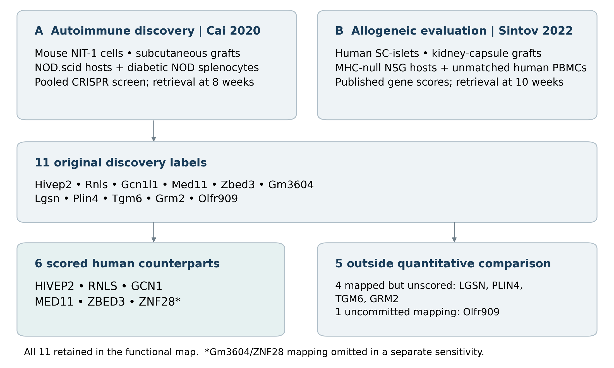
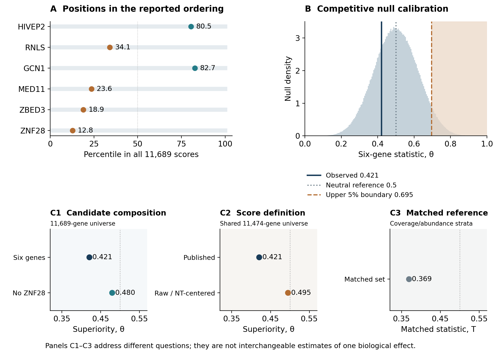
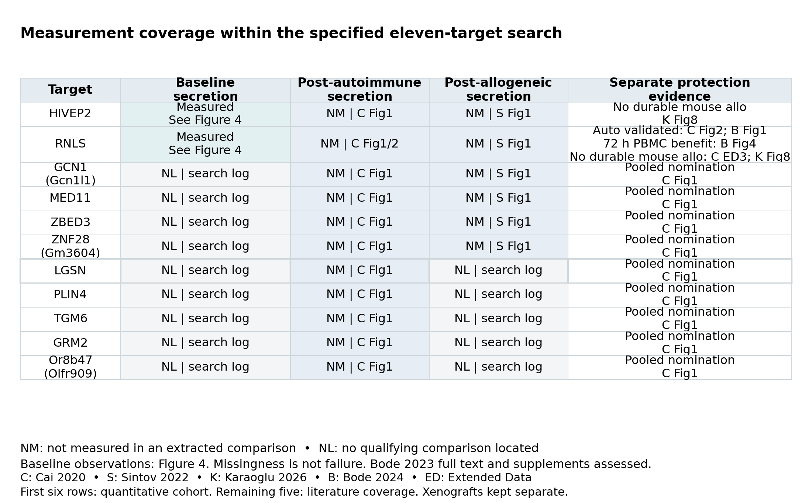
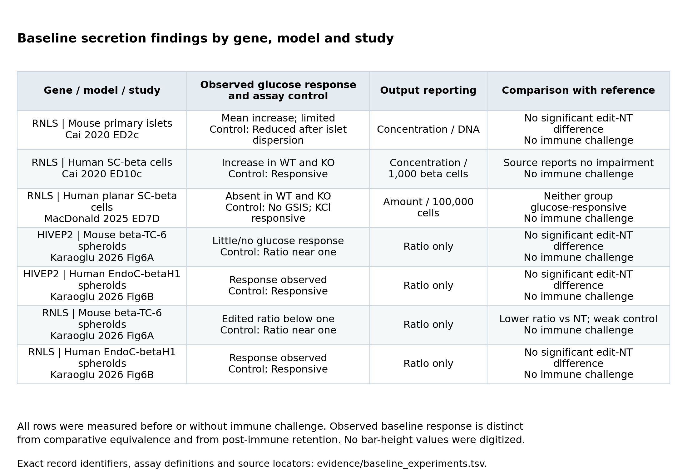

# Allogeneic screen performance and functional evidence

The revised analysis separates three questions rather than treating them as repeated evidence of biological failure.

| Question | Result | Interpretation |
|---|---|---|
| Do the six eligible candidates rank unusually highly? | Normalized Mann–Whitney theta = 0.421; one-sided p = 0.744 | No positive set-level enrichment detected under the specified competitive reference |
| Do individuals meet the source discovery threshold? | Two positive scores; zero positive scores with genome-wide q <= 0.05 | None meets that threshold; individual protective effects remain unresolved |
| Is retained post-immune glucose responsiveness adequately tested? | Located adequate comparisons: 0/6 scored candidates; 0/11 original targets | A measurement-coverage gap, not an observed biological failure rate |

Read the [paper](manuscript/paper.pdf) for the defined comparison, consistent literature coverage and experiment-specific functional observations. Calibration and matched-reference analyses are explicitly secondary, specified after the primary result was known.

## Eligibility and scope

Six human counterparts of eleven mouse autoimmune-screen discoveries were present in Sintov's 11,689-gene score table. LGSN, PLIN4, TGM6 and GRM2 were mapped but unscored; Olfr909 had no committed human counterpart. They were not assigned zero effects. The extended functional search includes all eleven, with current mouse alias Or8b47 recorded for Olfr909 without changing the frozen quantitative mapping.

This is a nominated-set analysis in another model, not full genome-wide screen concordance. Mouse NIT-1 subcutaneous grafts challenged with diabetic NOD splenocytes differ from human stem-cell-derived islet kidney grafts challenged with unmatched human PBMCs. Species, maturation, product, graft context and procedures change together; rejection type is not isolated.

## What the statistical calibration adds

Theta = 0.421 means that 42.1% of candidate-background score comparisons favor the candidate, counting ties by half. It is not a probability of protection. The exact original result is theta = 0.42096778795400724, p = 0.7438592561407439, with Monte Carlo standard error 0.0004365.

The central 95% of the original six-gene random-set reference is **0.271–0.730**, with an empirical upper 5% boundary of **0.695**. This is a null-reference range, not a biological confidence interval. Among 11,689 genes, only 98 meet positive score plus genome-wide q <= 0.05; a uniform six-gene sample has **95.07%** probability of containing none. Zero supported positive candidates is therefore not an additional surprising negative finding.

Stylized alternative-rank simulations show the design's conditional sensitivity. Diffuse mean rank quantiles of 0.60, 0.667, 0.75 and 0.833 produce detection frequencies of 19.4%, 40.1%, 76.3% and 98.4%. One strongly enriched candidate among five uniform candidates yields 10.7%. These are explicit hypothetical rank models, not observed power or estimated biological effects. Full rules, seeds and Monte Carlo errors are in [statistical calibration](docs/statistical_calibration.md).

## What changes under different assumptions

Excluding mapping-sensitive ZNF28 changes theta from **0.421 to 0.480** (p = 0.561). Nondetection persists, but the negative shift is substantially reduced. These are different statements about the decision and estimated magnitude.

The secondary joint matched-set test preserves candidate counts within original guide-count and control/pretransplant abundance strata. Its conditional statistic is **T = 0.369, p = 0.863**. GCN1 lies near the 94th percentile of its matched background and HIVEP2 near the 65th; this difference informs validation questions without establishing either edit as protective. Control-graft abundance was measured after transplantation and may reflect biological selection. Matching changes the estimand; it does not establish exchangeability, model biological intergene correlation or improve the same unrestricted effect estimate.

On the common **11,474-gene** universe, published scores give **theta = 0.421**, whereas descriptive log2(CPM + 1) contrasts give **theta = 0.495**. Subtracting one shared non-targeting reference changes signs but preserves every rank and the set statistic. Restored sign agreement is not replication of the primary rank result. Detailed guide annotation, animal depth, omission checks and source-model limitations remain in [the raw-count audit](docs/raw_count_audit.md).

## What function was measured

All eleven original targets now receive the same database search design, combining their original/current labels and authority-backed human/mouse aliases with the same beta-cell and function/protection terms and date boundary. One generation of backward/forward citations around the four original biological papers was checked, including primary bibliography reconciliation. Exact queries, counts, deduplication, source access and screening decisions are retained in the search logs.

The table contains **40 records**: 34 extracted experimental comparisons, five target-coverage records and one completed Bode 2023 source assessment. The latter six are not additional experiments. Repeated entries from one pooled screen are not independent replications. The full Bode 2023 text, all main figure legends and all six official supplementary files were assessed; no direct insulin-secretion or qualifying post-immune functional comparison was reported in that material. See the [source assessment](docs/bode2023_source_assessment.md).

Baseline secretion measurements were located for RNLS and HIVEP2. Adequate post-autoimmune or post-allogeneic basal/stimulated secretion comparisons were located for none of the six quantitative candidates, nor for the additional five discoveries. The evidence does not adequately test functional retention. There is no tested denominator for estimating a biological retention rate.

The [multidimensional matrix](evidence/functional_matrix.tsv) separates timing, basal/stimulated assessment, absolute output, assay responsiveness, comparison and protection. Its baseline cells point to seven model-specific measurements, rather than assigning a gene-wide function grade. An assay not measured in an extracted comparison and an assay not located in the bounded search remain distinct.

Cai's human SC-beta preparations showed glucose responsiveness in both wild-type and RNLS-knockout cells, and the paper reported no impairment. This favorable baseline observation does not require a formal noninferiority result to be informative. MacDonald's planar preparations lacked glucose responsiveness in both groups despite responding to KCl. Karaoglu's human spheroids were glucose responsive; mouse controls were weakly responsive, with a lower ratio for RNLS-edited spheroids. The [seven-row assay table](evidence/baseline_experiments.tsv) preserves these differences and source locators. All seven measurements preceded or omitted immune challenge.

RNLS autoimmune protection and mouse allogeneic failure were already published; RNLS/HIVEP2 spheroid failures concern specific graft models. The expanded search also identified Bode 2024's favorable 72-hour co-culture result with IL2-stimulated, HLA-mismatched PBMCs in human SC-derived beta-like cultures. Higher live CD45-negative counts and live/dead ratios support short-term cell survival in that setting. The endpoint was not beta-cell-marker gated and does not establish durable graft protection or retained secretion. Human-to-mouse grafts are xenogeneic. These context-specific outcomes do not establish post-challenge secretion failure. CXCL10 and STAT1 remain interpretation controls outside the eleven-target cohort.

## Scientific consequence and next experiment

Autoimmune-screen nomination alone should not be treated as evidence of established allogeneic protection. Nondetection does not preclude reasonable experimental prioritization based on biological plausibility, feasibility or expected information. GCN1 and HIVEP2 present different uncertain positive-score leads, while RNLS provides a context-dependence benchmark. None is established as a successful edit by this analysis.

A more discriminating experiment would test separately verified edits in one glucose-responsive human beta-cell product under unchallenged, autoimmune and allogeneic conditions, with independent preparations, differentiation batches and immune donors. It should jointly measure survival, total absolute basal/stimulated output, viable beta-cell mass and secretion per surviving cell. Technical wells are not biological replications.

Retained relative to prechallenge function, an unchallenged matched edit, a challenged unedited control and a minimum useful-output threshold are different claims. Relative benefit over a damaged control does not ensure adequate graft function. A justified retention margin and direct edit-by-challenge analysis would be needed; nonsignificance or a stimulation ratio alone is insufficient. These experiments were proposed, not performed.

## Reproducibility

The [README](README.md) gives the pinned environment, declared source cache and single offline reconstruction command. No clinical endpoints were measured, and AI-assisted internal checking is not external specialist validation.

Primary biological sources: [Cai 2020](https://doi.org/10.1038/s42255-020-0254-1), [Sintov 2022](https://doi.org/10.1016/j.stemcr.2022.08.002), [Karaoglu 2026](https://doi.org/10.3389/fimmu.2026.1759835), [MacDonald 2025](https://doi.org/10.1016/j.molmet.2025.102115), [Bode 2024](https://doi.org/10.3389/fimmu.2024.1403752), and [Bode 2023](https://doi.org/10.2337/db23-0030). Verified methodological references are recorded in [the reference audit](evidence/method_reference_audit.json).
